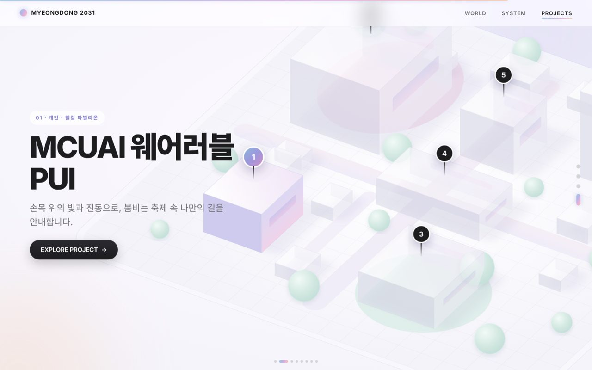

# College Festival 2031

AI와 함께하는 2031년 대학 축제를 스크롤 인터랙션으로 보여주는 웹 페이지입니다.
MCUAI가 축제 공간에서 상황을 감지하고, 판단하고, 대응하는 과정을 장면 중심으로 전달합니다.


| 세계관 | 시스템 | 질문 | 지도 투어 |
|---|---|---|---|
|  |  |  |  |

## 구성

| 순서 | 섹션 | 내용 |
|---|---|---|
| 01 | INTRO | 실시간 오로라 배경, 포털 전환, 첫 메시지 |
| 02 | WORLD | 3D 카드 덱과 챕터 번호로 4개 챕터 전환 |
| 02 | EPILOGUE | 기울어진 장면 카드 위로 핵심 문장 → 개인·공간·운영자 |
| 03 | SYSTEM | 3D로 기울어진 축제 장면에서 감지 → 판단 → 대응 시연 |
| — | QUESTION | 어두운 3D 공간, 글래스모피즘·분산·왜곡 효과 |
| 04 | PROJECTS | 구슬 3개가 지도에 착지 → 제품 6개 투어 → 자유 탐색 |
| — | DETAIL | 제품별 상세 페이지, 경험 스토리보드 |

## 폴더 구조

```
college-festival-2031/
├─ index.html            페이지 마크업
├─ assets/
│  ├─ css/style.css      전체 스타일
│  ├─ js/main.js         인터랙션·스크롤·3D 지도 스크립트
│  ├─ fonts/             Pretendard Variable (SIL OFL 라이선스 포함)
│  └─ images/            team-hero.webp, team-environment-01~05.webp
├─ docs/                 README용 미리보기 이미지
├─ .nojekyll             GitHub Pages가 파일을 그대로 서빙하도록 설정
└─ .gitignore
```

외부 라이브러리나 빌드 과정이 없는 순수 HTML·CSS·JavaScript입니다.
폰트와 이미지를 포함한 모든 파일이 프로젝트 안에 있어 **인터넷 연결 없이** 동작하며, 모든 경로는 상대 경로입니다.

## 실행

`index.html`을 브라우저로 열면 바로 실행됩니다.

로컬 서버로 확인하려면:

```bash
python3 -m http.server 8000
# http://localhost:8000 접속
```

## GitHub Pages 배포

1. 이 폴더 내용을 저장소 루트에 올립니다.
2. 저장소 **Settings → Pages**로 이동합니다.
3. **Source**를 `Deploy from a branch`, 브랜치를 `main`, 폴더를 `/ (root)`로 선택하고 저장합니다.
4. 1~2분 뒤 `https://<사용자명>.github.io/<저장소명>/` 주소로 접속할 수 있습니다.

## 조작

- 스크롤 / 트랙패드: 장면 전환 (정보 화면 근처에서 부드럽게 정렬)
- 키보드 ↑ ↓ · Page Up/Down · Space: 한 장면씩 이동
- 3D 지도: 드래그로 회전, ⌘/Ctrl + 스크롤로 확대
- 제품 핀 또는 투어 카드의 버튼: 제품 상세 열기
- `prefers-reduced-motion` 설정 시 움직임 효과가 줄어듭니다.

## 브라우저

최신 Chrome, Edge, Safari, Firefox (데스크톱·모바일)
