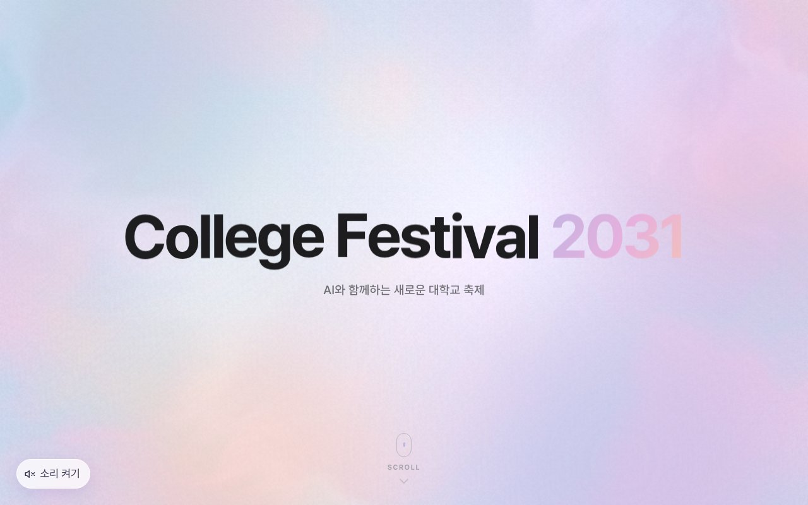
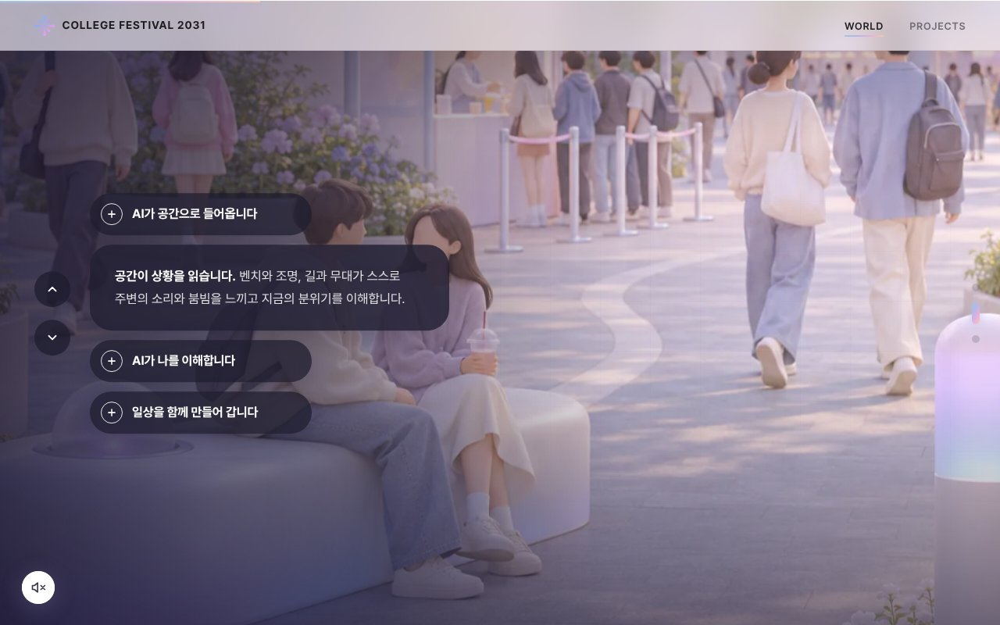
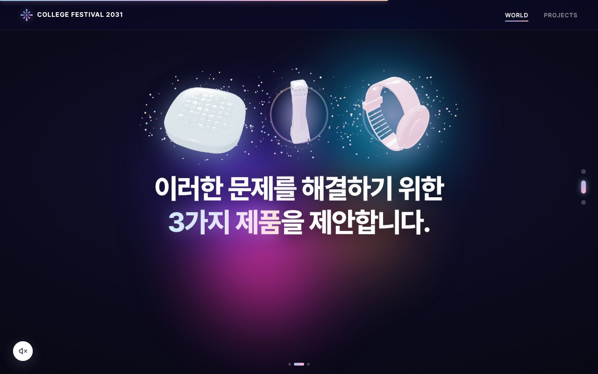
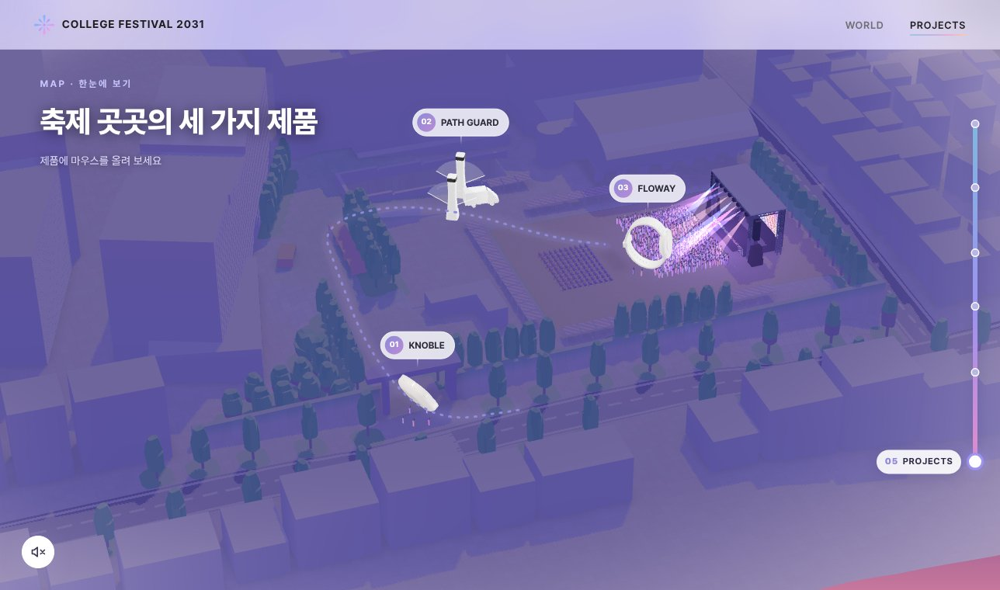

# College Festival 2031

AI와 함께하는 2031년 대학 축제를 스크롤 인터랙션으로 보여주는 웹 페이지입니다.
MCUAI가 축제 공간에서 상황을 감지하고, 판단하고, 대응하는 과정을 장면 중심으로 전달합니다.



| 세계관 | 에필로그 | 질문 | 지도 워크 |
|---|---|---|---|
|  |  |  |  |

## 구성

| 순서 | 섹션 | 내용 |
|---|---|---|
| 01 | INTRO | 실시간 오로라 배경, 글자·배경 색 혼합 인터랙션, 구름을 뚫고 축제 공간으로 내려앉는 비행 전환 |
| 02 | WORLD | 흩어진 카드에서 화면 전체 장면으로 확장, 왼쪽 알약 목록(Apple 기능 탐색 방식)에서 현재 챕터가 카드로 펼쳐지고 장면이 교차 전환. 위/아래 버튼·항목 클릭으로 이동 |
| 02 | EPILOGUE | 흐르는 파스텔 그라데이션 위 AI 대화 (대화 흐름·고른 장소에 따라 색이 바뀜), 핵심 문장과 파동 |
| — | QUESTION | "하지만," 글리치 등장 후 스크롤이 한 번 멈춤 → 어두운 3D 공간에 "과연" 질문 (오목 렌즈·비네트로 중앙 집중) → "이러한 문제를 해결하기 위한 3가지 제품" |
| 03 | PROJECTS | "3가지 제품"의 구슬 세 개가 화면 위로 날아갔다가, 제품 모양(사이트 톤의 펄 파스텔 재질)으로 카메라 밖에서 들어와 화면 가까이 나선을 그리며 멀어짐 — 가까울 땐 아웃포커스, 카메라 앞을 지날 땐 화면이 바람에 흔들림 — 지도에 안착하면 각 GLB 원본 재질(PBR·텍스처·발광)로 렌더링. 캠퍼스 3D 지도를 1인칭으로 걸으며 제품 3개(KNOBLE → PATH GUARD → FLOWAY) 순서대로 방문. 걸을수록 해가 지고 무대 앞에 관객이 모임 |

### 사운드

왼쪽 아래 스피커 아이콘으로 켭니다 (기본 꺼짐). 사운드 톤은 고정값(볼륨 80%, 오르골, 공간감 50%, 잔향 2%, 밝기 2%, 음높이 낮게, 반응음 켬)으로 설정되어 있습니다.
인트로·섹션 전환·카드 넘김·채팅·지도 이동·제품 열기·"하지만," 장면 등 특정 순간에만 효과음이 납니다.
D장조 펜타토닉 오르골·글래스 벨·핑퐁 에코로 경쾌하고 몽환적인 톤입니다.

## 폴더 구조

```
college-festival-2031/
├─ index.html            페이지 마크업
├─ assets/
│  ├─ css/style.css      전체 스타일
│  ├─ js/main.js         인터랙션·스크롤·3D 지도 스크립트
│  ├─ js/intro-flight.js 인트로 비행 전환 (구름을 지나 축제 공간으로)
│  ├─ js/prod3d.js       제품 GLB 렌더러 (three.js 번들, 오프라인) · prod3d.src.js 원본
│  ├─ js/products-glb.js 웹용 제품 GLB(base64, file:// 지원)
│  ├─ js/map-data.js     3D 지도용 모델 데이터 (campus.blend에서 변환, 제품 모델 포함)
│  ├─ models/            campus.blend (캠퍼스 원본), environment.glb (이전 지도 모델),
│  │                     products/knoble.glb · path-guard.glb · floway.glb (제품 원본), products/web/ (웹용 경량화본)
│  ├─ fonts/             Pretendard Variable (SIL OFL 라이선스 포함)
│  └─ images/            team-hero.webp, team-environment-01~05.webp
├─ PRODUCT01~03/         개인 제품 페이지 (KNOBLE · PATH GUARD · FLOWAY)
├─ docs/                 README용 미리보기 이미지
├─ .nojekyll             GitHub Pages가 파일을 그대로 서빙하도록 설정
└─ .gitignore
```

외부 라이브러리나 빌드 과정이 없는 순수 HTML·CSS·JavaScript입니다.
폰트와 이미지를 포함한 모든 파일이 프로젝트 안에 있어 **인터넷 연결 없이** 동작하며, 모든 경로는 상대 경로입니다.

## 실행

`index.html`을 브라우저로 열면 바로 실행됩니다.

로컬 서버로 확인하려면:

```bash
python3 -m http.server 8000
# http://localhost:8000 접속
```

## GitHub Pages 배포

1. 이 폴더 내용을 저장소 루트에 올립니다.
2. 저장소 **Settings → Pages**로 이동합니다.
3. **Source**를 `Deploy from a branch`, 브랜치를 `main`, 폴더를 `/ (root)`로 선택하고 저장합니다.
4. 1~2분 뒤 `https://<사용자명>.github.io/<저장소명>/` 주소로 접속할 수 있습니다.

## 조작

- 스크롤 / 트랙패드: 장면 전환 (정보 화면 근처에서 부드럽게 정렬)
- 키보드 ↑ ↓ · Page Up/Down · Space: 한 장면씩 이동
- "하지만," 장면에서는 스크롤이 약 1.5초 멈춘 뒤 다음 장면으로 넘어갑니다
- 상단 메뉴: WORLD에 올리면 ENTER·SENSE·UNDERSTAND·TOGETHER·EPILOGUE·QUESTION, PROJECTS에 올리면 KNOBLE·PATH GUARD·FLOWAY·FULL MAP으로 바로 이동
- 지도 워크: 스크롤로 길을 따라 이동, 드래그로 둘러보기
- 제품 라벨 또는 `EXPLORE PROJECT` 버튼: 개인 제품 페이지로 이동
- 제품 페이지의 `축제로 돌아가기`: 지도에서 해당 제품 위치로 복귀 (`index.html#product-N`)
- `prefers-reduced-motion` 설정 시 움직임 효과가 줄어듭니다.

## 브라우저

최신 Chrome, Edge, Safari, Firefox (데스크톱·모바일)

## 개인 제품 페이지

| 폴더 | 제품 | 상태 |
|---|---|---|
| `PRODUCT01/` | KNOBLE | 완성 — 지도에서 1번 제품을 누르면 이동 |
| `PRODUCT02/` | PATH GUARD | 완성 — 지도에서 2번 제품을 누르면 이동 |
| `PRODUCT03/` | FLOWAY (페이지 표기: FLOW DIAL) | 완성 — 지도에서 3번 제품을 누르면 이동 |

각 제품 페이지는 `index.html` + `assets/(images|videos|models|js|css|fonts)` 구조이고, 상대 경로만 사용합니다.
제품 페이지 상단: `전체 프로젝트`(../../index.html) · `COLLEGE FESTIVAL 2031`(조 페이지, ../index.html) · `축제로 돌아가기`(../index.html#product-N).
오프라인 테스트: 이 폴더에서 `python3 -m http.server` 실행 후 http://localhost:8000 접속 (파일 더블클릭으로도 동작).
